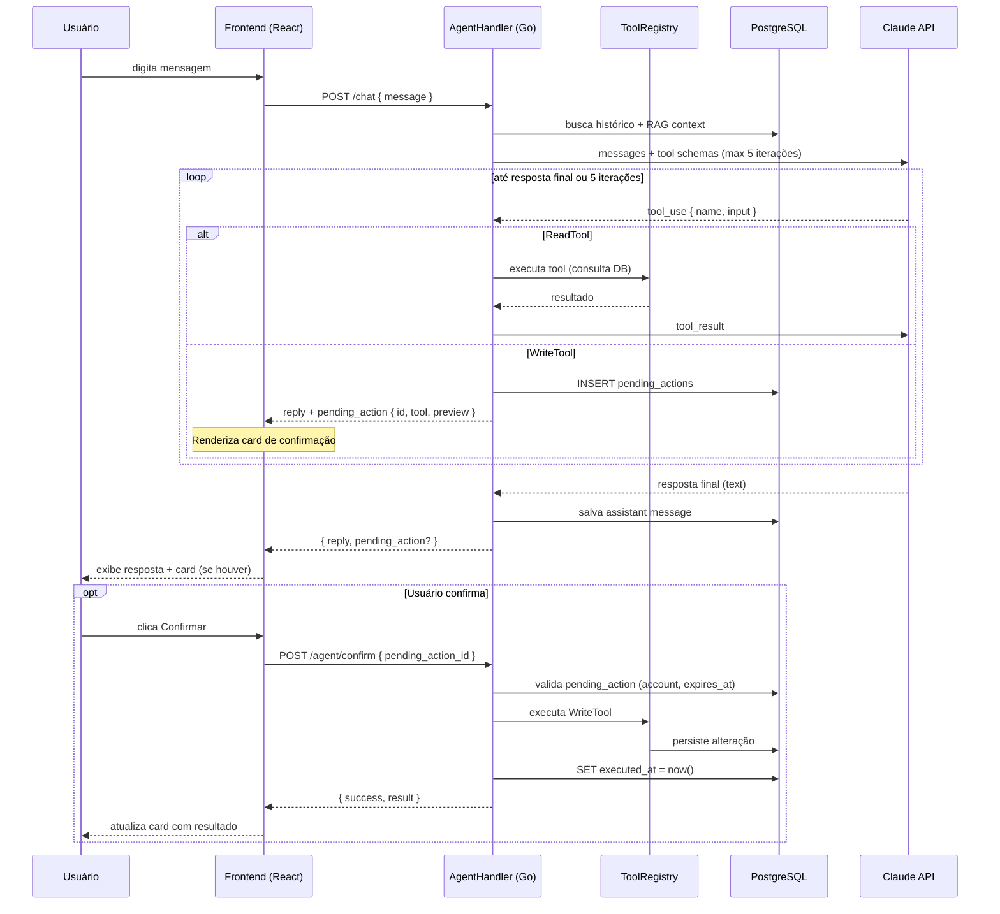
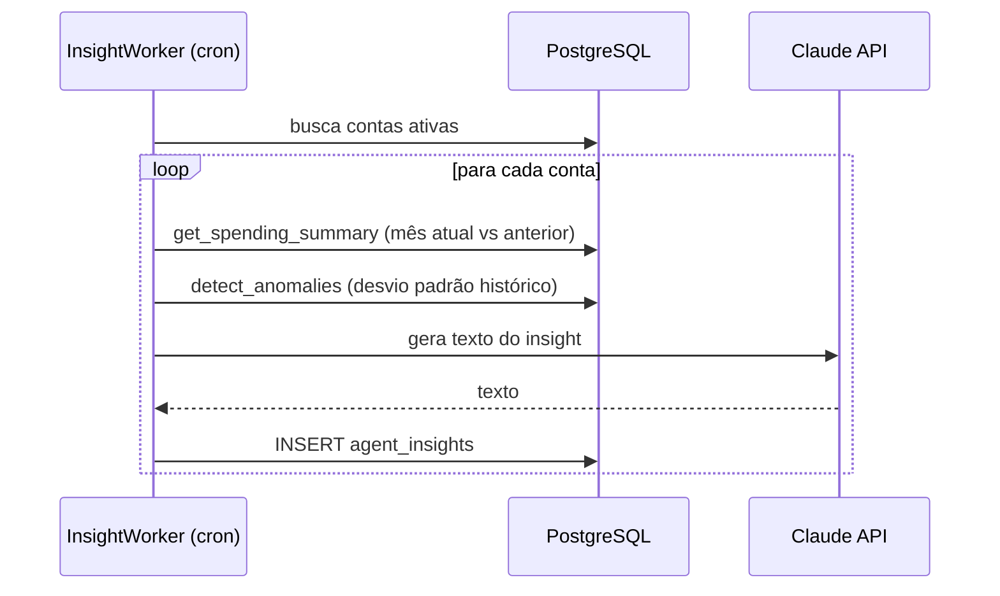
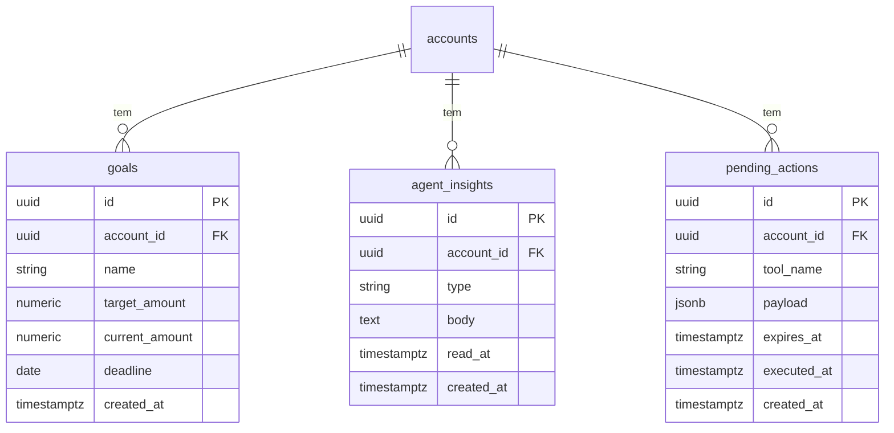

# Design: Financas como Agente LLM

## 1. Resumo da Solução

O app Financas já usa Claude para OCR de recibos e chat com RAG sobre o histórico financeiro. O chat atual tem uma capacidade de ação limitada: o Claude cria transações via tags `<action:register_transaction>` no texto, que o backend parseia e persiste automaticamente. Esse mecanismo é frágil — depende de parsing de texto livre, não tem confirmação do usuário e não é extensível para outros tipos de ação.

O objetivo é evoluir para uma arquitetura de agente real usando a API de tool use do Claude: ferramentas tipadas, loop de raciocínio explícito, e confirmação antes de qualquer criação ou modificação de dados. Isso cobre dois fluxos: (1) chat de texto — `create_transaction` vira WriteTool com confirmação, substituindo o mecanismo de tags; (2) upload de foto — após o OCR extrair os dados, o backend persiste um `PendingAction` e o frontend exibe um card de confirmação antes de salvar. O schema de banco existente não muda.

### Repositório afetado: `financas` (mono-repo)

| Camada | Natureza do impacto |
|--------|---------------------|
| Backend (Go) | Evolução do `ChatHandler` e `UploadHandler`, novo `ConfirmHandler`, novo `ToolRegistry`, novo `InsightWorker`, 3 novas tabelas |
| Frontend (React) | Card de confirmação no chat e no upload, Notification center, Dashboard panel |

### Objetivos
- Agente com tool use real (leitura + escrita com confirmação) no chat
- Confirmação obrigatória antes de salvar transações criadas via chat (`create_transaction` WriteTool) ou via upload de foto
- Remoção do mecanismo de tags `<action:register_transaction>` (substituído pela WriteTool)
- Insights proativos via worker periódico
- Metas financeiras criadas e acompanhadas pelo agente

### Não-objetivos
- Alterar tabelas existentes (`transactions`, `accounts`, `users`, etc.)
- Alterar o prompt de OCR (`ReceiptOCRPrompt`) ou a lógica de extração de dados do recibo

---

## 2. Arquitetura e Fluxo

### Diagrama de Sequência — Turno com Tool Use



### Diagrama de Sequência — InsightWorker



### Estrutura de Dados (novas tabelas)



---

## 3. Contratos de API

### POST /chat (modificado)

Endpoint existente — a request não muda. A response ganha campo opcional `pending_action`.

```
Endpoint: POST /chat
Auth: Bearer JWT (existente)

Request Body:
  { "message": string }

Response 200:
  {
    "reply": string,                  // texto do agente (existente)
    "pending_action": {               // presente apenas quando WriteTool foi acionada
      "id": string (uuid),
      "tool_name": string,
      "preview": string               // descrição legível da ação (ex: "Recategorizar 12 transações do iFood → Alimentação")
    } | null
  }
```

### POST /agent/confirm (novo)

```
Endpoint: POST /agent/confirm
Auth: Bearer JWT

Request Body:
  { "pending_action_id": string (uuid) }

Response 200:
  {
    "tool_name": string,
    "result": string    // mensagem de sucesso legível (ex: "12 transações atualizadas")
  }

Response 400: { "error": "invalid or expired action" }
Response 403: { "error": "action does not belong to this account" }
```

### GET /agent/insights (novo)

```
Endpoint: GET /agent/insights
Auth: Bearer JWT
Query: ?unread=true (opcional — filtra apenas não lidos)

Response 200:
  [
    {
      "id": string (uuid),
      "type": "anomaly" | "overspend" | "projection" | "suggestion",
      "body": string,
      "read_at": string (ISO8601) | null,
      "created_at": string (ISO8601)
    }
  ]
```

### PATCH /agent/insights/:id/read (novo)

```
Endpoint: PATCH /agent/insights/:id/read
Auth: Bearer JWT

Response 200: { "ok": true }
Response 404: { "error": "insight not found" }
```

### TypeScript — tipos para o frontend

```typescript
// Extensão da resposta do chat
interface ChatResponse {
  reply: string
  pending_action: PendingAction | null
}

interface PendingAction {
  id: string
  tool_name: string
  preview: string
}

interface ConfirmResponse {
  tool_name: string
  result: string
}

interface AgentInsight {
  id: string
  type: 'anomaly' | 'overspend' | 'projection' | 'suggestion'
  body: string
  read_at: string | null
  created_at: string
}
```

---

## 4. Implementação Técnica

### Backend (Go)

**Padrão de referência:** `internal/handlers/chat.go` + `internal/repository/transaction.go`

#### ToolRegistry (`internal/agent/registry.go`)

```go
type ReadTool interface {
    Name() string
    Schema() anthropic.ToolDefinition
    Execute(ctx context.Context, accountID uuid.UUID, input json.RawMessage) (any, error)
}

type WriteTool interface {
    Name() string
    Schema() anthropic.ToolDefinition
    Preview(input json.RawMessage) (string, error)   // descrição legível para o card
    Execute(ctx context.Context, accountID uuid.UUID, input json.RawMessage) (string, error)
}

type Registry struct {
    reads  map[string]ReadTool
    writes map[string]WriteTool
}
```

Tools de leitura que reutilizam repositórios existentes:
- `get_transactions` → `TransactionRepository.ListByAccountMonth`
- `get_spending_summary` → `TransactionRepository.SummaryByMonth`
- `get_categories` → query distinta sobre `transactions.category`
- `get_merchant_aliases` → `AliasRepository.List`
- `compare_periods` → duas chamadas a `SummaryByMonth` + delta
- `project_balance` → `SummaryByMonth` atual + projeção linear
- `detect_anomalies` → média e desvio padrão por categoria nos últimos 3 meses
- `get_goals` → `GoalRepository.List`

Tools de escrita (novas):
- `create_transaction` → `TransactionRepository.Create` (substitui mecanismo de tags; também reutilizado pelo UploadHandler após OCR)
- `update_transaction_category` → `TransactionRepository.Update` em lote
- `create_merchant_alias` → `AliasRepository.Create`
- `create_goal` → `GoalRepository.Create`
- `update_goal_progress` → `GoalRepository.Update`
- `add_transaction_note` → `TransactionRepository.Update` (campo `description`)

#### AgentHandler (`internal/handlers/chat.go` — evolução)

Loop de tool use sobre o `ChatHandler` existente:

```go
const maxToolIterations = 5

func (h *ChatHandler) Chat(w http.ResponseWriter, r *http.Request) {
    // ... setup igual ao atual (RAG, histórico) ...

    var pendingAction *PendingAction
    messages := buildMessages(history, req.Message)

    for i := 0; i < maxToolIterations; i++ {
        resp, _ := h.aiProvider.ChatWithTools(ctx, ai.ChatWithToolsRequest{
            Model:        ai.SelectModel(ai.TaskFinancialChat),
            SystemPrompt: systemPrompt,
            Messages:     messages,
            Tools:        h.registry.Schemas(),
            MaxTokens:    1024,
        })

        if resp.StopReason == "end_turn" {
            // resposta final — sai do loop
            break
        }

        for _, block := range resp.ToolUse {
            if h.registry.IsWrite(block.Name) {
                // persiste pending_action no banco, não executa
                pendingAction = h.savePendingAction(ctx, accountID, block)
                // adiciona tool_result vazio para o Claude continuar
                messages = append(messages, pendingActionMessage(block.ID))
            } else {
                result, _ := h.registry.ExecuteRead(ctx, accountID, block)
                messages = append(messages, toolResultMessage(block.ID, result))
            }
        }
    }

    respondJSON(w, http.StatusOK, chatResponse{
        Reply:         stripActionTags(finalContent),
        PendingAction: pendingAction,
    })
}
```

#### ConfirmHandler (`internal/handlers/agent.go` — novo)

```go
func (h *AgentHandler) Confirm(w http.ResponseWriter, r *http.Request) {
    accountID := auth.AccountIDFromContext(r.Context())
    var req struct { PendingActionID uuid.UUID `json:"pending_action_id"` }
    // decodifica, valida account + expires_at
    // executa WriteTool via registry
    // marca executed_at = now()
    // retorna result
}
```

#### InsightWorker (`internal/agent/insight_worker.go` — novo)

- Roda como goroutine com ticker (frequência configurável via env, padrão: 24h)
- Para cada `account_id` ativo: chama tools de análise, envia resultado ao Claude para gerar texto em português, persiste em `agent_insights`
- Não gera insight duplicado se já existe um não lido do mesmo tipo criado no dia

#### Migrations

Adicionadas ao `migrate.go` via `AutoMigrate`:
- `models.Goal`
- `models.AgentInsight`
- `models.PendingAction`

#### AI Provider — extensão da interface

```go
type ChatWithToolsRequest struct {
    Model        string
    SystemPrompt string
    Messages     []Message
    Tools        []ToolDefinition
    MaxTokens    int
}

type ChatWithToolsResponse struct {
    Content    string
    StopReason string  // "end_turn" | "tool_use"
    ToolUse    []ToolUseBlock
}

// Provider recebe novo método:
ChatWithTools(ctx context.Context, req ChatWithToolsRequest) (ChatWithToolsResponse, error)
```

---

### Frontend (React/TypeScript)

**Padrão de referência:** `frontend/src/pages/Chat.tsx` + hooks em `frontend/src/hooks/`

#### Mudanças no Chat

- `useChat` hook: ao receber `pending_action` na response, armazena em estado local
- Novo componente `<ConfirmationCard>`: renderizado inline na thread quando `pending_action` presente
  - Exibe `preview` da ação
  - Botões "Confirmar" (chama `POST /agent/confirm`) e "Cancelar" (limpa estado)
  - Após confirmação: exibe `result` e invalida queries relacionadas (transações, metas)

#### Notification Center (novo)

- Novo componente `<NotificationCenter>` no header (ícone de sino + badge)
- Query: `GET /agent/insights?unread=true` via React Query (`useAgentInsights`)
- Clicar num insight: marca como lido (`PATCH /agent/insights/:id/read`) + abre chat com mensagem pré-carregada

#### Dashboard Panel (novo)

- Novo componente `<AgentInsightsPanel>` na página Dashboard
- Exibe os 3 insights mais recentes
- Botão "Ver no chat" navega para `/chat` com contexto

#### State Management

- `useAgentInsights`: React Query, cache 5min, invalidado após marcar como lido
- `usePendingAction`: estado local no hook `useChat` (não persistido — expira com a sessão)
- `useConfirmAction`: mutation React Query que chama `POST /agent/confirm` e invalida `useTransactions` + `useGoals`

---

## 5. Garantia de Comportamento do Chat

O comportamento do agente é garantido por três camadas independentes — a camada 2 é a crítica:

**1. System prompt estruturado**
- Regras explícitas: nunca executar escrita sem confirmar, apresentar lista dos itens afetados, uma pergunta por turno quando ambíguo
- Few-shot com exemplos de fluxo correto

**2. Imposição no backend (camada crítica)**
- `AgentHandler` inspeciona cada `tool_use` block retornado pelo Claude
- Se a tool está registrada como `WriteTool`, **nunca executa** — persiste `pending_action` e retorna ao frontend
- O Claude fisicamente não consegue disparar uma escrita sem passar pelo `ConfirmHandler`
- `ConfirmHandler` valida `account_id` + `expires_at` — ação expirada (TTL: 30 min) retorna 400

**3. Tool descriptions como contrato**
- Cada `WriteTool` inclui na description: `"REQUER CONFIRMAÇÃO DO USUÁRIO. Apresente os itens afetados e aguarde aprovação explícita antes de usar."`

---

## 6. Mapa de Dependências

```
[Backend] Estender interface ai.Provider com ChatWithTools
  └── [Backend] Implementar ToolRegistry com ReadTools e WriteTools
        └── [Backend] Evoluir ChatHandler para loop de tool use
              └── [Backend] Implementar ConfirmHandler + rota POST /agent/confirm
                    └── [Frontend] Card de confirmação no chat (useChat + ConfirmationCard)

[Backend] Criar models Goal, AgentInsight, PendingAction + AutoMigrate
  ├── [Backend] Implementar GoalRepository
  │     └── [Backend] Tools create_goal, update_goal_progress, get_goals
  └── [Backend] Implementar InsightWorker
        └── [Backend] Rotas GET /agent/insights + PATCH /agent/insights/:id/read
              └── [Frontend] NotificationCenter + AgentInsightsPanel
```

---

## 7. Pré-Quebra de Tarefas

### Backend

| # | Título | Tipo | Depende de |
|---|--------|------|-----------|
| B1 | Estender `ai.Provider` com `ChatWithTools` e implementar no Claude client | backend | — |
| B2 | Criar `ToolRegistry` com interfaces `ReadTool` / `WriteTool` | backend | B1 |
| B3 | Adicionar models `Goal`, `AgentInsight`, `PendingAction` + AutoMigrate | backend | — |
| B4 | Criar `GoalRepository` | backend | B3 |
| B5 | Implementar ReadTools: `get_transactions`, `get_spending_summary`, `get_categories`, `get_merchant_aliases`, `compare_periods`, `project_balance`, `detect_anomalies` | backend | B2 |
| B6 | Implementar ReadTool `get_goals` | backend | B2, B4 |
| B7 | Implementar WriteTools: `create_transaction`, `update_transaction_category`, `create_merchant_alias`, `add_transaction_note` | backend | B2 |
| B8 | Implementar WriteTools: `create_goal`, `update_goal_progress` | backend | B2, B4 |
| B9 | Evoluir `ChatHandler` para loop de tool use com `ToolRegistry`; remover `extractTransactions` e `stripActionTags` | backend | B2, B5, B6, B7, B8 |
| B10 | Modificar `UploadHandler` para persistir `PendingAction` em vez de salvar direto | backend | B3, B7 |
| B11 | Implementar `ConfirmHandler` + rota `POST /agent/confirm` | backend | B9, B10 |
| B12 | Implementar `InsightWorker` com ticker e persist em `agent_insights` | backend | B3, B5 |
| B13 | Implementar rotas `GET /agent/insights` + `PATCH /agent/insights/:id/read` | backend | B12 |

### Frontend

| # | Título | Tipo | Depende de |
|---|--------|------|-----------|
| F1 | Atualizar tipos `ChatResponse` e `UploadResponse` para incluir `pending_action` | frontend | B9, B10 |
| F2 | Criar mutation `useConfirmAction` | frontend | B11, F1 |
| F3 | Criar componente `<ConfirmationCard>` reutilizável (chat + upload) | frontend | F2 |
| F4 | Integrar `<ConfirmationCard>` no chat após resposta do agente | frontend | F3 |
| F5 | Integrar `<ConfirmationCard>` no upload após extração do OCR | frontend | F3 |
| F6 | Criar hook `useAgentInsights` (GET + PATCH read) | frontend | B13 |
| F7 | Criar componente `<NotificationCenter>` no header | frontend | F6 |
| F8 | Criar componente `<AgentInsightsPanel>` no Dashboard | frontend | F6 |

---

## 8. Restrições e Cuidados

- **Loop infinito**: máximo de 5 iterações no loop de tool use; se atingido, retorna a última resposta parcial com log de aviso
- **PendingAction expirada**: TTL de 30 minutos; após expirar, `ConfirmHandler` retorna 400 — frontend deve tratar e exibir mensagem adequada
- **PendingAction já executada**: `executed_at` não nulo → retornar 400 "already executed" para evitar dupla execução
- **Concorrência**: dois usuários do mesmo `account_id` confirmando a mesma ação — resolver com check de `executed_at IS NULL` em UPDATE atômico
- **Remoção das tags**: `extractTransactions` e `stripActionTags` são removidos do `ChatHandler`; `create_transaction` WriteTool é o único caminho de criação via chat
- **Upload com confirmação**: `UploadHandler` para de chamar `txRepo.Create` diretamente — persiste `PendingAction` com todas as transações extraídas e retorna o ID para o frontend exibir o card
- **Custo de tokens**: o loop de tool use aumenta o número de tokens por turno; monitorar via logs de uso da API do Claude
- **InsightWorker duplicatas**: checar se já existe insight não lido do mesmo `type` criado nas últimas 24h antes de inserir novo
- **Testes**: cada `ReadTool` e `WriteTool` deve ter teste unitário independente do handler; `ConfirmHandler` deve ter teste de validação de ownership e expiração
